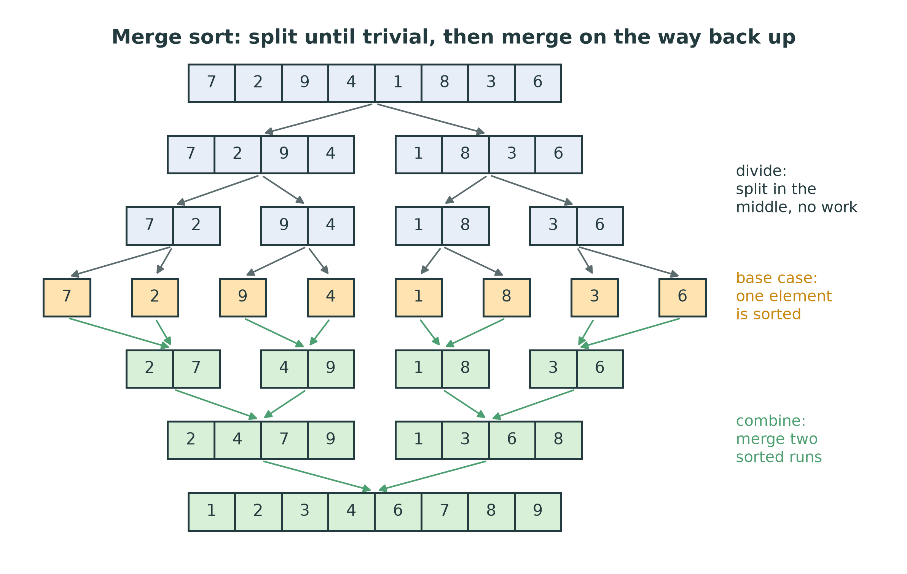
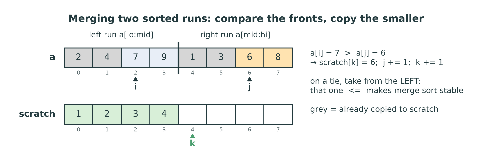
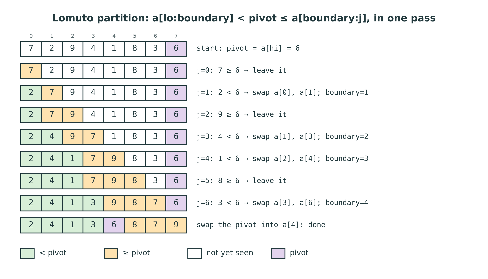
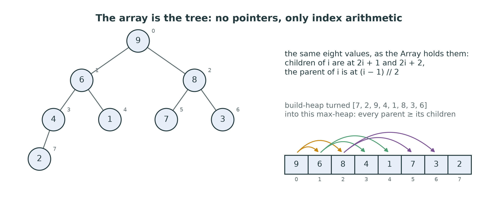
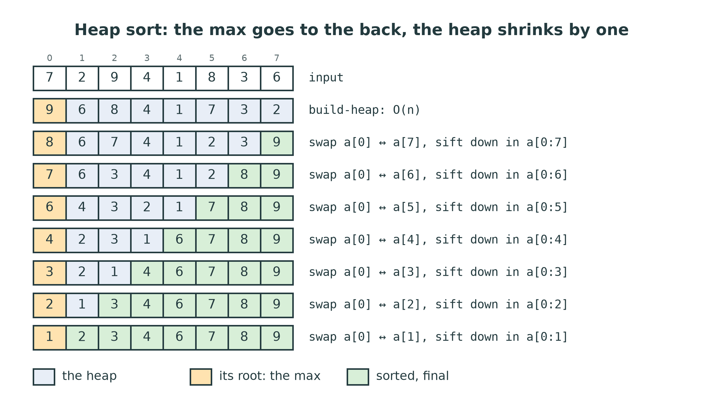

::: {.handout-only}

> **How to read this document.** This is the handout for Lecture 10. It holds
> everything on the slides, plus what I said out loud. Last week's three sorts
> cost $O(n^2)$; this week, three sorts that cost $O(n \log n)$ — merge sort,
> quicksort and heap sort. Each is taught the way Lecture 09 taught its sorts —
> the idea, one step, the code, the whole run, the cost — on **one list**, so
> that you learn the pattern once and then only the differences. Boxes marked
> **Deeper** hold the parts that are examined but are not needed to follow the
> lecture; read them second.
>
> Slides: `DSA27-L10-slides.pdf` · Code: `dsa/sorting.py` (the second half) ·
> Tests: `tests/test_sorting.py -k "merge or quick or heap"` ·
> Interactive demo: [Fast Sorting Lab](https://helghareeb.github.io/DSA27/lectures/10-sorting-advanced/fast-sorting-lab.html) ·
> Practise online: [Week 10 quiz and written practice](https://helghareeb.github.io/en/quizzes/dsa27/week-10/) (in [Arabic](https://helghareeb.github.io/ar/quizzes/dsa27/week-10/))

:::

## From $n^2$ to $n \log n$

Week 9: bubble, selection, insertion — **$O(n^2)$** comparisons.

| n | $n^2 / 2$ | $n \log_2 n$ |
|---|---|---|
| 1,000 | 500,000 | 10,000 |
| 1,000,000 | 500,000,000,000 | 20,000,000 |

Today: three sorts in the right-hand column — and the price each one pays.

::: {.handout-only}

At a million values, an $O(n^2)$ sort does about 25,000 times more work than
an $O(n \log n)$ one. No constant factor closes a gap like that; only a
different algorithm does. Week 9's sorts move an element one place per
comparison; this week's sorts let one comparison settle the order of many
elements at once.

*Merge sort*: الترتيب بالدمج. *Quicksort*: الترتيب السريع. *Heap sort*:
الترتيب بالكومة.

:::

## Today: one list, one pattern

$$L = [7,\ 2,\ 9,\ 4,\ 1,\ 8,\ 3,\ 6]$$

Every sort today, on the same list, in Week 9's five beats:

1. **Idea** — one sentence
2. **One step** — a picture
3. **Code** — short, plain Python
4. **The whole run** — predict first, then look
5. **Cost** — time, extra space, stable or not

::: {.handout-only}

On L the three sorts make 17 (merge), 14 (quick, last-element pivot) and 27
(heap) comparisons. On eight values that says little; the shapes of their
**worst cases** say a lot, and that is the story of today.

:::

## Divide and conquer

1. **Divide** the problem into smaller problems of the same kind.
2. **Conquer** each one — recursively, until it is trivial.
3. **Combine** their answers into the answer.

Merge sort: divide is free, **combine** does the work.
Quicksort: **divide** does the work, combine is free.

::: {.handout-only}

*Divide and conquer*: فرق تسد. You have met it twice: Lecture 03's recursions
trusted the recursive call to solve the smaller part, and Lecture 08's binary
search kept only **one** half, which is why it costs $\log n$. This week both
halves are kept, and each must be sorted. Merge sort cuts the array in the
middle without looking at it and does all its thinking when it **merges**.
Quicksort thinks first — it **partitions** around a pivot — and then there is
nothing left to combine.

:::

# Merge Sort

## Merge sort

**Idea:** split in the middle until each piece has one value; **merge** sorted pieces on the way back up.

{width=60%}

::: {.handout-only}

Going down, each range is cut at `mid = (lo + hi) // 2` — no comparisons, no
moves. At the bottom every range holds one value, and **a one-value list is
sorted**: that is the base case. Going up, neighbouring sorted runs are merged
into one, until the whole array is one run. The merged rows are the real
states of the reference code, in the order of a recursive call tree: the left
half completely, then the right half, then the two together.

:::

## Merging two sorted runs

{width=92%}

Compare the two **fronts**; copy the smaller to `scratch`; advance that side.
When one run is empty, copy the rest of the other.

::: {.handout-only}

**One step** is one merge. This is the last merge of L: the runs
`[2, 4, 7, 9]` and `[1, 3, 6, 8]`. Four values have gone (1, 2, 3, 4); now 7 is
compared with 6, and 6 goes. Each comparison sends exactly one value to
`scratch`, so two runs of lengths $n_1$ and $n_2$ merge in at most
$n_1 + n_2 - 1$ comparisons. You wrote this merge in Week 2 with a loop, and in
Week 3 recursively — Lecture 03 warned that the recursive one is too deep for
long lists, "a good reason why merge sort's real merge step is a loop". Here
it is.

:::

## `_merge`: the code

::: {.slides-only}

```{=latex}
\scriptsize
```

:::

```python
def _merge(a, lo, mid, hi, scratch):    # runs a[lo:mid] and a[mid:hi]
    i, j, k = lo, mid, lo
    while i < mid and j < hi:
        if a[i] <= a[j]:                # <= : on a tie, take the LEFT one
            scratch[k] = a[i]
            i += 1
        else:
            scratch[k] = a[j]
            j += 1
        k += 1
    while i < mid:                      # copy what is left of the left run
        scratch[k] = a[i]
        i += 1
        k += 1
    while j < hi:                       # ... or of the right run
        scratch[k] = a[j]
        j += 1
        k += 1
    for k in range(lo, hi):             # copy the merged range back
        a[k] = scratch[k]
```

**Common mistake:** `<` instead of `<=` — it still sorts, but it is no longer stable.

::: {.handout-only}

The runs are half-open ranges, as in Lecture 08's bounds. `i` walks the left
run, `j` the right run, and `k` the next free slot of `scratch`. After the main
loop **one** run is empty and only one of the two "leftover" loops does
anything. The last loop copies the merged range back, because the next merge up
the tree reads from `a`. When `a[i]` and `a[j]` are equal, `<=` takes the value
from the **left** run — the one that came first in the input. That one
character is the whole of merge sort's stability.

:::

## Merge sort: the code

```python
def merge_sort(a):
    scratch = [None] * len(a)           # one scratch list for every merge
    sort(a, 0, len(a), scratch)
    return a

def sort(a, lo, hi, scratch):           # sort a[lo:hi]
    if hi - lo <= 1:                    # 0 or 1 values: already sorted
        return
    mid = (lo + hi) // 2
    sort(a, lo, mid, scratch)           # divide and conquer: left half
    sort(a, mid, hi, scratch)           #                     right half
    _merge(a, lo, mid, hi, scratch)     # combine
```

**Common mistake:** `if hi - lo == 0` — a one-value range then recurses forever.

::: {.handout-only}

The three steps of divide and conquer are the three lines in the middle:
compute `mid`, sort both halves, merge. A range of one value is the base case:
test `hi - lo <= 1`. Test only for an empty range and a one-value range splits
into an empty half and a one-value half — itself again — until Python raises
`RecursionError`.

**One scratch list, made once.** A new scratch list in every call would also
be correct, but n calls each allocating up to n slots is wasteful. A merge of
`a[lo:hi]` only uses `scratch[lo:hi]`, so one list of n slots is enough.

:::

## Merge sort: the whole run

**Predict:** how many levels of merging does L need? How much work is each level?

::: {.slides-only}

. . .

:::

{width=86%}

$\log_2 n$ levels, $n$ work per level: **$O(n \log n)$** — best, average and worst case.

::: {.handout-only}

L has 8 values: 3 levels of merging ($\log_2 8$), 7 merges, 17 comparisons.
The ranges on one level partition the array, so every level touches all n
values; the ranges halve, so after $\log_2 n$ levels they have one value.
Total: $n \log_2 n$. *Recursion tree*: شجرة الاستدعاءات.

**Cost.** Merge sort splits in the middle whatever the values are, so **no
input is bad for it**: $O(n \log n)$ always. **Stable**, because of the `<=`.
**Not in place**: `scratch` holds n slots, plus $O(\log n)$ for the call stack.

> **Deeper — the recurrence, and sorted input.** A **recurrence** (Lecture 03)
> states the cost in terms of the cost on smaller inputs: two sorts of n/2
> values plus a merge of n, so $T(n) = 2T(n/2) + n$, with $T(1) = 1$.
> Unrolled: $T(n) = 2T(n/2) + n = 4T(n/4) + 2n = \dots = 2^k T(n/2^k) + kn$;
> stop at $k = \log_2 n$: $T(n) = n + n \log_2 n = O(n \log n)$. On **sorted**
> input each merge ends when the left run empties, after half the comparisons:
> 5,120 comparisons for 1,024 sorted values against 8,935 for random ones. The
> **moves** are the same either way. Merging is also how data **too big for
> memory** is sorted: sort chunks that fit, write each sorted run to disk, then
> merge the runs from the files — *external sorting*.

:::

# Quicksort

## Quicksort

**Idea:** pick a **pivot**; put the smaller values left of it and the rest right of it. Then sort the two sides.

$$\underbrace{\;< \text{pivot}\;}_{\text{left part}} \quad \text{pivot} \quad \underbrace{\;\geq \text{pivot}\;}_{\text{right part}}$$

After a partition the pivot is in its **final place**. Nothing to combine.

::: {.handout-only}

C. A. R. Hoare invented quicksort in 1959 and published it in 1961. *Pivot*:
المحور. *Partition*: التقسيم. Everything smaller is left of the pivot and
everything larger or equal is right of it, and sorting those two parts cannot
change that. So each partition fixes **one** value for good and splits the rest
into two smaller, independent problems. How much smaller depends entirely on
the pivot — and that is the story of quicksort.

:::

## Lomuto's partition

{width=62%}

::: {.handout-only}

**One step** is one partition. Lomuto's scheme (popularised by Jon Bentley,
because it is easier to get right than Hoare's) uses the **last** value as the
pivot, one index `j` that scans left to right, and one `boundary`:

- `a[lo:boundary]` holds values **< pivot** (green);
- `a[boundary:j]` holds values **$\geq$ pivot** (amber);
- `a[j:hi]` is not looked at yet (white); `a[hi]` is the pivot.

If `a[j]` is at least the pivot, the amber region grows by one and nothing
moves. If it is smaller, it is swapped with the first amber value and
`boundary` moves right. At the end one last swap puts the pivot between the
two regions. On L the pivot is 6; 2, 4, 1 and 3 are smaller and end up in
`a[0:4]`; the pivot lands at index 4. **7 comparisons**, one per non-pivot
value: $n - 1$, always.

:::

## `_partition`: the code

```python
def _partition(a, lo, hi):             # a[lo..hi], both ends included
    pivot = a[hi]
    boundary = lo
    for j in range(lo, hi):
        if a[j] < pivot:
            a[boundary], a[j] = a[j], a[boundary]
            boundary += 1
    a[boundary], a[hi] = a[hi], a[boundary]   # the pivot to its final place
    return boundary
```

**Invariant:** `a[lo:boundary] < pivot <= a[boundary:j]`.

**Common mistake:** forgetting the last swap — the pivot is then not between the parts.

::: {.handout-only}

Note the ranges: here `lo` and `hi` are **inclusive**, with the pivot at `hi`
— unlike `_merge`, whose `hi` is excluded. Both are fine; mixing them up inside
one function is not. The invariant is true before the loop (both regions are
empty), each step keeps it true, and at the end the final swap moves the first
amber value to the end — which keeps it amber — and puts the pivot at
`boundary`. `a[j] < pivot` is strict, so values **equal** to the pivot go
right: a list of a thousand equal values partitions into 0 and 999, the worst
case again. Industrial quicksorts use a three-way partition (<, =, >) for this
reason; it is not required here.

:::

## Quicksort: the code

```python
def quick_sort(a):
    sort(a, 0, len(a) - 1)
    return a

def sort(a, lo, hi):                   # sort a[lo..hi]
    if lo >= hi:                       # 0 or 1 values: already sorted
        return
    p = _partition(a, lo, hi)          # the pivot lands at p, for good
    sort(a, lo, p - 1)                 # the smaller values
    sort(a, p + 1, hi)                 # the larger values
```

**Common mistake:** `sort(a, lo, p)` — the pivot is sorted again, forever.

::: {.handout-only}

The pivot at `p` is final, so it belongs to **neither** recursive call. Include
it — `sort(a, lo, p)` — and a range whose last value is its largest partitions
into itself again: the recursion never shrinks, and Python raises
`RecursionError`. On L, five partitions place the pivots 6, 3, 1, 9 and 7; the
other three values end in ranges of one value, the base case. 14 comparisons in
all.

:::

## Quicksort: the worst case

**Predict:** what happens on **sorted** input, with an end value (first or last) as the pivot?

::: {.slides-only}

. . .

:::

{width=86%}

Every partition peels off **one** value: $(n-1) + (n-2) + \dots + 1 = n(n-1)/2$: **$O(n^2)$**.

::: {.handout-only}

On sorted input an end value is the smallest or the largest in its range every
time (the figure uses the first value). One part is empty, the other has all the rest, and the next
partition is only one value shorter: n levels for n values. Counted, not
guessed: `quick_sort(list(range(n)), pivot="first")` makes exactly $n(n-1)/2$
comparisons — 523,776 for n = 1,024, and 2,096,128 for n = 2,048, four times as
many for twice the input. `"first"` and `"last"` are equally bad on sorted
input. This is not a curiosity: sorted and nearly sorted data are the **most
common** inputs a real sort receives.

:::

## Choosing the pivot

| `pivot=` | picks | on sorted input |
|---|---|---|
| `"first"`, `"last"` | an end of the range — free | $O(n^2)$: always the min or the max |
| `"random"` | a random index | no fixed input is bad for it |
| `"median3"` (default) | the median of first, middle, last | the exact middle: $O(n \log n)$ |

The chosen pivot is swapped to `a[hi]`; then `_partition` runs as before.

::: {.handout-only}

The course's `quick_sort(values, pivot="median3")` takes the strategy by name.
The chosen index is swapped with `a[hi]`, so `_partition` never needs to know
how the pivot was chosen:

```python
p = _choose_pivot(a, lo, hi, pivot, rng)
a[p], a[hi] = a[hi], a[p]
q = _partition(a, lo, hi)
```

**random** needs bad luck at every level to go wrong; the reference seeds its
generator (`random.Random(27)`) so that the animation is the same every time.
**median3** — R. C. Singleton's suggestion (1969) — spends up to three extra
comparisons to get a pivot that is never the smallest or largest of those
three; on sorted input it is the exact middle. It is written with comparisons,
not with `sorted()`:

```python
mid = (lo + hi) // 2
first, middle, last = a[lo], a[mid], a[hi]
if first <= middle <= last or last <= middle <= first:
    return mid
if middle <= first <= last or last <= first <= middle:
    return lo
return hi
```

With `pivot="median3"` the sorted inputs that cost 523,776 and 2,096,128
comparisons above cost only 9,228 and 20,493.

> **Deeper — why the average is $O(n \log n)$.** Call a pivot *good* if it
> lands in the middle half of its range, so that neither part holds more than
> ¾ of it. After a good pivot the larger part shrinks by ¾, so a chain of good
> pivots reaches size 1 after $\log_{4/3} n \approx 2.4 \log_2 n$ steps. A
> random pivot is good half the time, so it takes about two partitions to get
> one good one: about $2 \times 2.4 \log_2 n$ levels of at most n comparisons —
> still $O(n \log n)$. The exact analysis gives $2n \ln n \approx
> 1.39\, n \log_2 n$ expected comparisons. In practice quicksort is often the
> **fastest** of the three: one comparison and at most one swap per step, in
> place, scanning memory in order.

:::

## Quicksort: the cost

- **Time:** $O(n \log n)$ on average; $O(n^2)$ in the worst case.
- **Extra space:** $O(\log n)$ — the course version **recurses on the smaller side**.
- **Not stable:** the partition swaps across long distances.

::: {.handout-only}

**Not stable.** On six cards compared by number, `[3a, 1b, 3c, 2d, 1e, 2f]`,
the course `quick_sort` gives `[1b, 1e, 2d, 2f, 3c, 3a]` — **3c before 3a**:
the pivot 3c is swapped to the end, the smaller values are swapped to the front
one by one, pushing 3a along, and the final swap leaves 3a behind its equal.
The stability figure in "Stable or not" shows the whole comparison.

> **Deeper — the stack depth.** The code on the slide makes two recursive
> calls. On sorted input with an end pivot its recursion is n deep, one frame
> per peeled-off value, and Python stops at 1,000 frames: it crashes with
> `RecursionError` on a sorted list of a few thousand values — exactly when it
> is also at its slowest. The course version makes a recursive call only for
> the **smaller** part and handles the larger part by updating `lo` or `hi`
> and going round a loop — the tail call turned into a loop, as in Lecture 03:
>
> ```python
> def sort(lo, hi):
>     while lo < hi:
>         p = _choose_pivot(a, lo, hi, pivot, rng)
>         a[p], a[hi] = a[hi], a[p]
>         q = _partition(a, lo, hi)
>         yield snapshot(a), (q,)
>         if q - lo < hi - q:
>             yield from sort(lo, q - 1)
>             lo = q + 1
>         else:
>             yield from sort(q + 1, hi)
>             hi = q - 1
> ```
>
> Each call is on a range at most half its caller's, so the stack is at most
> $\log_2 n$ frames deep, whatever the pivots. The time on a bad input is still
> $O(n^2)$; only the space is fixed. `test_quick_sort_survives_its_worst_case_input`
> sorts `list(range(200))` with the default pivot, so it cannot catch the deep
> version; Lab 10 has you try `pivot="first"` on 1,000 values.

:::

# Heap Sort

## Heap sort

**Idea:** turn the array into a **max-heap** — every parent $\geq$ its children — so the maximum is at `a[0]`. Swap it to the back; repeat.

{width=86%}

::: {.handout-only}

This is Week 12 arriving early. Any array can be **read** as a complete binary
tree: `a[0]` is the root, and the children of `a[i]` are `a[2i + 1]` and
`a[2i + 2]`. The tree is not stored anywhere — no nodes, no pointers, only
index arithmetic. *Heap*: الكومة. A max-heap is **not** sorted — in the figure
7 is a level lower than 6, although 7 > 6 — but its maximum is at the root, where it can
be read in $O(1)$. The tree is **complete**, so its height is
$\lfloor \log_2 n \rfloor$, and walking from the root to a leaf costs
$O(\log n)$. The figure is L after build-heap: `[9, 6, 8, 4, 1, 7, 3, 2]`.

:::

## Sift down: repair one parent

::: {.slides-only}

```{=latex}
\footnotesize
```

:::

```python
def _sift_down(a, index, size):        # the heap is a[0:size]
    while True:
        largest = index
        left, right = 2 * index + 1, 2 * index + 2
        if left < size and a[left] > a[largest]:
            largest = left
        if right < size and a[right] > a[largest]:
            largest = right
        if largest == index:           # at least as large as both children
            return
        a[index], a[largest] = a[largest], a[index]
        index = largest                # follow the value down
```

**Common mistake:** swapping with the first larger child, not the **largest** one.

::: {.handout-only}

**One step** is one sift. `_sift_down` assumes that both subtrees of `index`
are already heaps and only `a[index]` may be too small. It swaps `a[index]`
with its **larger** child until it is at least as large as both children, or
has none. Swap with just any larger child and the child that moves up can be
smaller than its new sibling: the heap breaks. `size` says where the heap ends,
so that the sorted part at the back is never touched. One swap per level: at
most $\log_2 n$ swaps, $O(\log n)$.

:::

## Heap sort: the code

```python
def heap_sort(a):
    n = len(a)
    for i in range(n // 2 - 1, -1, -1):    # 1. build a max-heap: O(n)
        _sift_down(a, i, n)
    for end in range(n - 1, 0, -1):        # 2. the max goes to the back
        a[0], a[end] = a[end], a[0]
        _sift_down(a, 0, end)              #    repair the heap in a[0:end]
    return a
```

**Common mistake:** building the heap from the root **down** — the subtrees are not heaps yet.

::: {.handout-only}

**Build-heap.** The leaves — the last $\lceil n/2 \rceil$ slots — are
one-value heaps already. Sift every parent, from the last one, `n // 2 - 1`,
back to the root: when a node is sifted, its subtrees are already heaps, which
is exactly what `_sift_down` needs. Go the other way, from the root, and the
root is sifted before its subtrees are heaps: the maximum can stay buried.

**Sort.** The maximum is at `a[0]`. Swap it with `a[end]`, where it belongs for
good; the heap is one shorter, and only its new root may break the heap
property — one `_sift_down`. Repeat $n - 1$ times.

:::

## Heap sort: the whole run

**Predict:** after build-heap, which value goes to the back first? And second?

::: {.slides-only}

. . .

:::

{width=58%}

::: {.handout-only}

9, then 8: each swap takes the current maximum, so the sorted part grows from
the back, largest first — like selection sort. Heap sort **is** selection sort,
with a heap to find the maximum in $O(\log n)$ instead of $O(n)$. On L, 27
comparisons.

**Cost.** $O(n \log n)$ **always** — no bad input, like merge sort. $O(1)$
extra space — in place, like quicksort, and no recursion at all. **Not
stable**: the swap to the back jumps over equals. Slower in practice: its sift
reads `a[i]` and then `a[2i + 1]`, far away for large i, so the processor's
caches help little; and it makes more comparisons — about $1.7\, n \log_2 n$
on random data. Its real job is as a **safety net**: C++'s `std::sort` is
*introsort*, a quicksort that switches to heap sort when its recursion gets too
deep.

> **Deeper — why build-heap is $O(n)$.** n/2 sifts of up to $\log n$ each
> suggests $O(n \log n)$ — true, but not tight. Most nodes are near the bottom,
> where a sift is short: about n/4 nodes can sink 1 level, n/8 can sink 2, n/16
> can sink 3, and only the root can sink $\log_2 n$. The total is at most
> $n\,(1/4 + 2/8 + 3/16 + \dots) = n$ swaps. This is R. W. Floyd's improvement
> (1964) on J. W. J. Williams's heapsort of the same year; Week 12 proves it.

:::

# Which One, When

## Six sorts, one picture

{width=96%}

::: {.handout-only}

Each point is a **count** of comparisons, made by the reference
`dsa/sorting.py` on values whose `<`, `<=`, `>` and `>=` add 1 to a counter —
the trick of `CountingReads` in Lab 08. Counts do not depend on your machine.

**Left, random input.** The three $O(n^2)$ sorts climb with slope 2 on the
log–log plot; the three $O(n \log n)$ sorts with slope just over 1. At
n = 4,096: merge sort 43,943, quicksort (median of three) 61,330, heap sort
85,710. The dotted line is $\log_2(n!)$, the fewest comparisons **any**
comparison sort can guarantee, and merge sort sits almost on it. So does
`sorted()`: 43,939.

**Right, sorted input.** `pivot="first"` is the red line with slope 2 —
$n(n-1)/2$ exactly. `random` and `median3` stay with the $n \log n$ group.
Merge sort needs only $\tfrac12 n \log_2 n$ here, and heap sort does not care.
Python's `sorted()` makes **n – 1** comparisons — 1,023 at n = 1,024 —
because it notices that the input is one sorted run.

> **Deeper — no comparison sort beats $\log_2(n!)$.** A comparison
> sort must tell apart all $n!$ orders of its input, and each comparison has
> two outcomes, so it needs at least $\log_2(n!) \approx n \log_2 n - 1.44\,n$
> comparisons in the worst case (Lecture 09's decision tree): merge sort and
> heap sort are optimal up to a constant. For n = 1,024, $\log_2(1024!) \approx
> 8{,}769$, and merge sort used 8,935. Counting sort escapes because it never
> compares.

:::

## `sorted()` and `list.sort()`: Timsort with Powersort

*Enrichment — not examinable.*

1. Find the **runs** already in the data (reversing descending ones).
2. Extend short runs with **binary insertion sort**.
3. **Merge** adjacent runs, stably, using $O(n)$ extra space. Since CPython
   3.11, **Powersort** chooses the merge order.

Sorted input: one run, **n – 1 comparisons**. Worst case: $O(n \log n)$.

::: {.handout-only}

Tim Peters's **Timsort** is a stable, adaptive merge sort. It finds **natural
runs** by scanning for stretches that already have an order. It turns descending
runs around, preserving the order of equal keys, and uses binary insertion sort
to extend short runs. During a merge, when values keep coming from the same run,
it can switch to **galloping**: an exponential search (Lecture 08) for how much
of that run can be copied at once. On already sorted input, CPython finds a
single run in $n-1$ comparisons and has nothing to merge.

**What changed in CPython 3.11?** CPython adopted Munro and Wild's **Powersort**
to choose which adjacent runs to merge first. Run detection, binary insertion
sort, stable merging, and galloping are still part of the sort. The change is
in the order of the merges.

**Why does order matter?** Suppose the three runs are `A(96) | B(32) | C(32)`.
Use the sum of the two run lengths as the cost of a merge.

| Merge order | First merge | Final merge | Total cost |
|---|---:|---:|---:|
| `(A + B) + C` | 128 | 160 | 288 |
| `A + (B + C)` | 64 | 160 | 224 |

Merging the two short runs first lets the 96 items of `A` take part in only
one merge. The table counts run lengths as a model of work. Actual comparison
counts also depend on the values and on shortcuts such as galloping.

**How does Powersort choose?** Each boundary between two runs gets a *node
power*. On a scale from 0 to 1, look at the two run midpoints and find the
first binary digit where they differ. That digit's position, counting from 1,
is the power. In the example, the midpoints are 0.30, 0.70, and 0.90. The
`A | B` boundary has power 1 because the midpoints straddle $1/2$. The
`B | C` boundary has power 2 because both midpoints are in the right half
but straddle $3/4$. Higher powers sit deeper in the merge tree and are merged
first here, so `B + C` comes before the final merge with `A`. This rule gives
near-optimal merge cost for the distribution of run lengths.

The [CPython 3.11 changelog](https://docs.python.org/3.11/whatsnew/changelog.html#python-3-11-0-alpha-1)
records the change, and the [CPython design notes](https://github.com/python/cpython/blob/main/Objects/listsort.txt)
explain how the run stack uses the powers.

Java uses Timsort for object arrays and dual-pivot quicksort for primitive
arrays. In 2015, de Gouw and colleagues found a bug in OpenJDK's Timsort while
formally verifying its run-stack invariant.

What this means for you: in your own programs, use `sorted()` or
`list.sort()`, and `key=` for anything but plain values. In `dsa/sorting.py`,
the point is that you can write the algorithms it is made of.

:::

## Stable or not

{width=86%}

Six cards, compared by their **number only**. Merge sort keeps a before c; quicksort and heap sort swap equal pairs.

::: {.handout-only}

*Stable*: مستقر. Stability matters as soon as you sort **records by one
field**: sort students by name, then **stably** by grade, and within each grade
they are still in name order. Merge sort keeps a before c, b before e and d
before f, because its merge takes from the left run on a tie. Quicksort's
partition and heap sort's swap-to-the-back move values across long distances
and swap equal pairs (red). **Testing stability needs the right values.**
Sorting `(key, tag)` tuples proves nothing — Python compares the tag too when
the keys are equal. Compare by the key alone: a small class whose comparison
methods look only at the key, as in `tools/figures_l10.py` (`Card`) and Lab 10.

:::

## The table to remember

| Sort | Best | Average | Worst | Extra space | Stable |
|---|---|---|---|---|---|
| bubble · insertion | $n$ | $n^2$ | $n^2$ | $O(1)$ | yes |
| selection | $n^2$ | $n^2$ | $n^2$ | $O(1)$ | no |
| **merge** | $n \log n$ | $n \log n$ | $n \log n$ | $O(n)$ | **yes** |
| **quick** | $n \log n$ | $n \log n$ | $n^2$ | $O(\log n)$ | no |
| **heap** | $n \log n$ | $n \log n$ | $n \log n$ | $O(1)$ | no |
| Timsort (`sorted`) | $n$ | $n \log n$ | $n \log n$ | $O(n)$ | yes |

**Choose:** guarantee + stable → merge · fastest in place → quick (random or median3) · worst case, no memory → heap.

::: {.handout-only}

Times are in comparisons. **quick** extra space $O(\log n)$ is with the
smaller-side recursion; the naive version needs $O(n)$ stack in the worst case.
Its worst case is $n^2$ for every fixed pivot rule; with `random`, only with
vanishing probability. **heap** best case is with distinct keys; if every key
is equal each sift stops at once and it is $O(n)$. **Tiny or nearly sorted
arrays:** insertion sort — which is why Timsort and introsort both use it at
the bottom. Counting sort (Week 9, $O(n + k)$) is not in the table because it
does not compare.

:::

# This Week

## Watching your own code

`dsa/sorting.py` = the same code + a copy into an `Array` + `yield` lines.

```python
    def sort(lo, hi):
        ...
        yield from sort(lo, mid)       # NOT just sort(lo, mid)
        yield from sort(mid, hi)
        _merge(a, lo, mid, hi, scratch)
        yield snapshot(a), tuple(range(lo, hi))
```

::: {.handout-only}

As in Week 9, each sort has a `_steps` form that yields a frame after each
step, and the plain form runs it to the end. The recursive sorts add one new
thing. `sort` is itself a generator, so calling `sort(lo, mid)` only
**creates** a generator and runs nothing. **`yield from`** runs it and passes
each of its frames up to whoever is iterating `merge_sort_steps`. Forget it —
write `sort(lo, mid)` on its own line — and nothing below the top level is ever
sorted: the sort returns the input barely changed, and the tests fail.

> **Deeper — the price of watching, again.** A frame made with `list(a)` copies
> the whole array: after each of the $n - 1$ merges, n values — $O(n^2)$
> copying, more than the sort itself. With that version `merge_sort` took 0.36,
> 1.29 and 4.7 seconds for 1,000, 2,000 and 4,000 values: four times as long
> for twice the input. So every `_steps` form takes a `snapshot` parameter —
> `list` by default, so the animation gets fresh frames — and the plain form
> passes a function that returns `a` itself. With it the same runs took 0.06,
> 0.12 and 0.27 seconds, the $n \log n$ shape. Lab 10, Part 8, has you measure
> both.

:::

## Exercises, and the Fast Sorting Lab

| Function | The trap |
|---|---|
| `merge_sort_steps` | `yield from` the recursive calls; `<=` in the merge; one scratch `Array` |
| `quick_sort_steps` | Lomuto's invariant; swap the pivot to `hi`; smaller side first |
| `heap_sort_steps` | build from `n // 2 - 1` **down** to 0; sift with `size = end` |

```powershell
pytest tests/test_sorting.py -v -k "merge or quick or heap"
```

[**Fast Sorting Lab**](https://helghareeb.github.io/DSA27/lectures/10-sorting-advanced/fast-sorting-lab.html): today's three sorts, line by line, on L or on your own list.

::: {.handout-only}

37 tests: each sort on the eight fixed cases (empty, one, two, five mixed
values, duplicates, sorted, reversed, negatives), 20 random lists, "does not
mutate the input", the two generator tests, and quicksort on sorted input.
Write the private helpers — `_merge`, `_partition`, `_choose_pivot`,
`_sift_down` — as the lecture does; the tests only call the public names. Two
things the tests do **not** check, and the lab does: stability, and the pivot
strategies on sorted input. The storage rule holds: copy the input into an
`Array`, sort it, return a list. No `sorted()`, `list.sort()` or `heapq` inside
`dsa/sorting.py`.

**The Fast Sorting Lab** runs the code of this lecture one line at a time: the
array and `scratch`, the regions of the partition, the heap drawn as a tree,
the call stack, and the comparisons so far. Try sorted input with each pivot
rule and watch the call stack; switch on **What happens next?** to answer
before each step; run each sort's **common mistake**; and sort the **cards** to
see which sorts keep a before c.

- **Online:** <https://helghareeb.github.io/DSA27/lectures/10-sorting-advanced/fast-sorting-lab.html>
- **Offline:** open `docs/lectures/10-sorting-advanced/fast-sorting-lab.html`
  from your copy of the repository. It is a single file and needs no
  installation.

:::

## Homework 10 — before Lecture 11

1. **Implement** merge, quick and heap sort until the 37 tests pass.
2. **Trace** `_partition` on `[5, 8, 1, 9, 3, 7, 2, 6]` as a table of `j`,
   `a[j]`, `boundary` and the array.
3. **Draw** the merge tree of `merge_sort([6, 5, 3, 1, 8, 7, 2, 4])`.
4. **Count** comparisons for `quick_sort(list(range(n)), pivot)` with
   `"first"` and `"median3"`, n = 100, 200, 400. Predict first.
5. **Break it:** change `<=` to `<` in `_merge`. Which tests fail? What else
   changes?

Then: the [**Week 10 quiz**](https://helghareeb.github.io/en/quizzes/dsa27/week-10/) — 22 questions and 5 written ones, every answer explained ([Arabic](https://helghareeb.github.io/ar/quizzes/dsa27/week-10/)).

::: {.handout-only}

For item 4, reuse the idea of Lab 08's `CountingReads`: a class whose
comparison methods add to a counter (Lab 10, Part 6). Before you run it:
$n(n-1)/2$ for `"first"`; for `"median3"`, a little over $n \log_2 n$. For item
5, predict before you run. (A hint: which of the tests compares values that are
equal **but distinguishable**?) Do the quiz **after** the homework, as a check,
not instead of it.

:::

## Seven things to keep

1. **Divide and conquer:** split, solve the parts recursively, combine.
2. **Merge sort:** $T(n) = 2T(n/2) + n = O(n \log n)$ always; $O(n)$ extra;
   stable because of one `<=`.
3. **Quicksort:** partition around a pivot; the pivot lands in its final place.
4. An end pivot on sorted input: $n(n-1)/2$ comparisons — **measured**.
   Random or median-of-three: $O(n \log n)$ on average.
5. Recurse on the **smaller** part: $O(\log n)$ stack, always.
6. **Heap sort:** the array is the tree; build-heap $O(n)$; $O(n \log n)$
   always, $O(1)$ extra, not stable.
7. No comparison sort beats $\log_2(n!) \approx n \log_2 n$. Python's
   `sorted()` exploits existing runs. CPython 3.11 and later use **Powersort**
   to schedule their merges.

**Next — Week 11:** binary search trees — and an in-order walk gives the values **sorted**, one more sort for free.

::: {.handout-only}

Keep the pivot story in mind. A binary search tree built by inserting sorted
values is exactly quicksort with an end pivot: every new value goes to the
right of all the others, and the "tree" becomes a linked list, n deep. The same
bad input, the same cure (balance), in a different structure.

---

## Sources and further reading

- **C. A. R. Hoare.** "Algorithm 64: Quicksort", *Communications of the ACM*
  4(7), 1961; and "Quicksort", *The Computer Journal* 5(1), 1962.
- **J. W. J. Williams.** "Algorithm 232: Heapsort", *Communications of the ACM*
  7(6), 1964; **R. W. Floyd.** "Algorithm 245: Treesort 3", *Communications of
  the ACM* 7(12), 1964 — build-heap in linear time.
- **R. C. Singleton.** "Algorithm 347: An efficient algorithm for sorting with
  minimal storage", *Communications of the ACM* 12(3), 1969 — median of three.
- **D. E. Knuth.** *The Art of Computer Programming*, vol. 3, *Sorting and
  Searching*, 2nd ed., Addison-Wesley, 1998, §5.2 and §5.3.1 — merge sort
  (which Knuth traces to John von Neumann, 1945), quicksort, heapsort, and the
  $\log_2(n!)$ lower bound.
- **J. Bentley.** *Programming Pearls*, 2nd ed., Addison-Wesley, 1999, column
  11, "Sorting" — Lomuto's partition.
- **R. Sedgewick and K. Wayne.** *Algorithms*, 4th ed., Addison-Wesley, 2011,
  §2.2–2.4 — mergesort, quicksort (with the average-case analysis), heapsort.
- **D. R. Musser.** "Introspective sorting and selection algorithms",
  *Software: Practice and Experience* 27(8), 1997 — introsort.
- **T. Peters.** `Objects/listsort.txt` in the CPython source — Timsort,
  explained by its author.
- **J. I. Munro and S. Wild.** "Nearly-optimal mergesorts: fast, practical
  sorting methods that optimally adapt to existing runs", ESA 2018 — powersort.
- **S. de Gouw, J. Rot, F. S. de Boer, R. Bubel and R. Hähnle.** "OpenJDK's
  java.utils.Collection.sort() is broken: the good, the bad and the worst
  case", CAV 2015.

Every figure in this lecture is generated by `tools/figures_l10.py` from the
states and counts of a working `dsa/sorting.py` (run it with
`python tools/with_solutions.py tools/figures_l10.py` to use the reference).

:::
